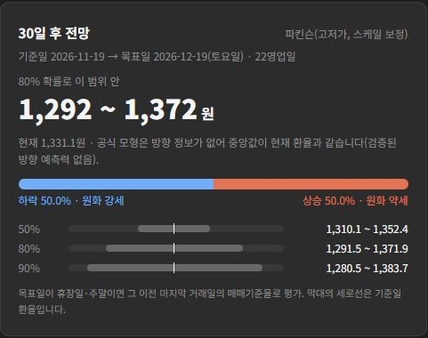

올해 한국 수출이 1조 달러를 돌파했습니다. 반도체가 이끈 기록적인 성과입니다. 그런데 올해 외환시장에서는 수출 실적만큼이나 흥미로운 현상이 나타나고 있습니다.

미국의 추가 긴축으로 달러는 강세를 보이고, 외국인 투자자들은 한국 주식을 대규모로 팔아치웠습니다. 통상 이런 상황이라면 원화값이 떨어질 가능성이 큽니다. 하지만 원화는 오히려 주요국 통화 가운데 가장 강한 모습을 보였습니다.

한국은행에 따르면 올해 하반기 원화 절상률은 11월 12일 기준 13.3%로 주요국 통화 중 가장 높았습니다. 달러화지수(DXY)가 1.8% 상승하는 동안 원화값은 13% 넘게 오른 겁니다.

핵심은 반도체 달러입니다.

반도체 수출이 급증하면서 한국으로 막대한 달러가 들어오고 있습니다. 지난 9월 경상수지 흑자는 614억6000만 달러로 역대 최대를 기록했습니다. 수출기업들이 벌어들인 달러를 원화로 바꾸면 외환시장에 달러 공급이 늘어납니다.

강달러와 외국인 주식 매도에 따른 원화 약세 압력을 반도체 수출로 벌어들인 달러가 상당 부분 완충하고 있는 것으로 보입니다.

그렇다면 앞으로 원화는 얼마나 더 강해질 수 있을까요.

제가 만든 환율 분석 서비스 'FX워치'의 최신 데이터를 살펴봤습니다.
11월 19일 오후 1시 34분 기준 원·달러 환율은 1331.1원입니다. 지난 9일 1357.9원에서 26.8원 하락했습니다. 달러당 원화값이 내려갔다는 것은 그만큼 원화가 강해졌다는 의미입니다.

FX워치의 통계모형이 제시한 7일 후 환율의 80% 예상 구간은 1312.7~1349.8원입니다. 30일 후에는 1291.5~1371.9원으로 범위가 넓어집니다.

과거 환율 움직임과 변동성을 바탕으로 향후 환율이 어느 범위에 분포할지를 확률로 계산한 결과입니다.

눈에 띄는 건 30일 예상 구간의 하단이 1291원대라는 점입니다. 현재의 원화 강세 흐름이 이어지고 돌발적인 대외 충격이 없다면 원·달러 환율이 1300원 아래로 내려가는 것도 불가능하지 않다는 의미입니다.

이런 해석에 힘을 실어주는 것이 FX워치의 압력지수입니다.

FX워치에는 뉴스 흐름을 분석하는 뉴스 압력지수(FSI)와 금리·금융시장 변수 등을 반영한 통계 압력지수(FPI)가 있습니다. 두 지수 모두 마이너스면 원화 강세 압력이 우세하다는 의미입니다.

19일 두 지표가 나란히 원화 강세 방향을 가리켰습니다.

뉴스 압력지수(FSI)는 18일 +23.2에서 19일 -17.2로 급격히 방향을 바꿨습니다. 전날까지 원화 약세를 압박하던 뉴스 흐름이 하루 만에 강세 쪽으로 돌아선 겁니다.

통계 압력지수(FPI)도 -3.5를 기록했습니다. 뉴스뿐 아니라 실제 금융시장 변수에서도 원화 강세 방향의 압력이 나타난 것입니다.

두 지표가 같은 방향을 가리킨다는 점이 중요합니다. 뉴스에서 포착된 원화 강세 요인이 금융시장 지표의 움직임과도 맞아떨어지고 있다는 뜻입니다.

변동성도 비교적 안정적입니다.

19일 FX워치의 변동성지수(FXVI)는 21.23입니다. 최근 20거래일의 일중 변동성을 과거 같은 시장 국면과 비교한 지표인데, 현재 변동성이 상대적으로 낮은 구간에 있다는 의미입니다.

환율 하락 압력은 나타나고 있지만 시장이 극심하게 요동치는 상황은 아닌 것입니다.

종합하면 현재 외환시장은 반도체 수출 호황에 따른 달러 공급 확대가 원화 강세의 기반을 형성한 가운데, 뉴스와 금융시장 변수도 같은 방향을 가리키고 있습니다. 변동성 역시 비교적 낮습니다.

1300원 아래로의 추가 하락을 생각해볼 수 있는 환경입니다.

여기서 또 하나 흥미로운 질문이 생깁니다.

이렇게 강해진 원화가 우리 경제에는 어떤 영향을 미칠까요.

19일 한국은행 조사국이 발표한 '원화절상의 경제적 영향: 부문별 파급 차별화와 양극화 완화 가능성' 보고서가 답을 제시했습니다.

원화값이 10% 상승하면 내수기업의 영업이익률은 1.4%포인트, 투자율은 3.3%포인트, 매출증가율은 7.4%포인트 높아지는 것으로 추정됐습니다.
수출기업은 원화로 환산한 매출이 줄어 채산성이 나빠질 수 있지만, 내수기업은 수입 원자재와 중간재를 더 저렴하게 구입할 수 있습니다. 생산비용이 줄어들고 가계의 구매력이 높아지면 내수기업의 매출에도 도움이 됩니다.

가계에도 혜택이 돌아갑니다.

원화값이 10% 상승하면 가구당 연간 생활비가 평균 16만5000원 줄어드는 것으로 추정됐습니다. 절감액의 약 78%는 에너지와 식료품, 외식비에서 발생합니다.

특히 저소득층에 상대적으로 유리합니다. 처분가능소득 대비 생활비 절감률은 소득 하위 20%가 0.78%로 상위 20%(0.24%)의 3.25배였습니다.
반도체 호황의 혜택이 일부 대기업과 고소득층에 집중되는 상황에서 원화 강세가 내수기업과 저소득층에도 이익을 전달하는 통로가 될 수 있다는 분석입니다.

물론 수입 원가가 낮아진 만큼 기업들이 판매가격을 내려야 가계의 생활비 절감 효과도 커집니다. 이번 연구는 원화 강세가 경제적 양극화를 완화할 수 있는 경로를 구체적인 수치로 보여줬다는 데 의미가 있습니다.

최근 외환시장에서 벌어지는 일은 단순한 환율 등락 이상의 의미가 있습니다.

반도체 수출 호황이 달러 공급을 늘리고, 그 달러가 원화값을 떠받치며, 강해진 원화가 다시 내수기업과 가계의 구매력을 높이는 구조입니다.

반도체 호황의 성과가 수출기업의 실적에만 머물지 않고 경제 전반으로 확산될 가능성이 생긴 것입니다.

외환시장에서도 이런 변화가 나타나고 있습니다. 강달러와 외국인 자금 이탈에도 원화가 상대적으로 강한 모습을 보이는 배경입니다.

제가 만든 FX워치는 이처럼 변화하는 외환시장을 데이터로 관찰하는 서비스입니다. 원·달러 환율의 7일·30일 확률분포와 시장 압력, 변동성, 주요 아시아 통화와의 동조화를 매일 분석합니다.

수출 1조 달러 시대. 그 성과가 우리 경제와 원화의 가치를 어떻게 바꿔놓을지 궁금해집니다. 