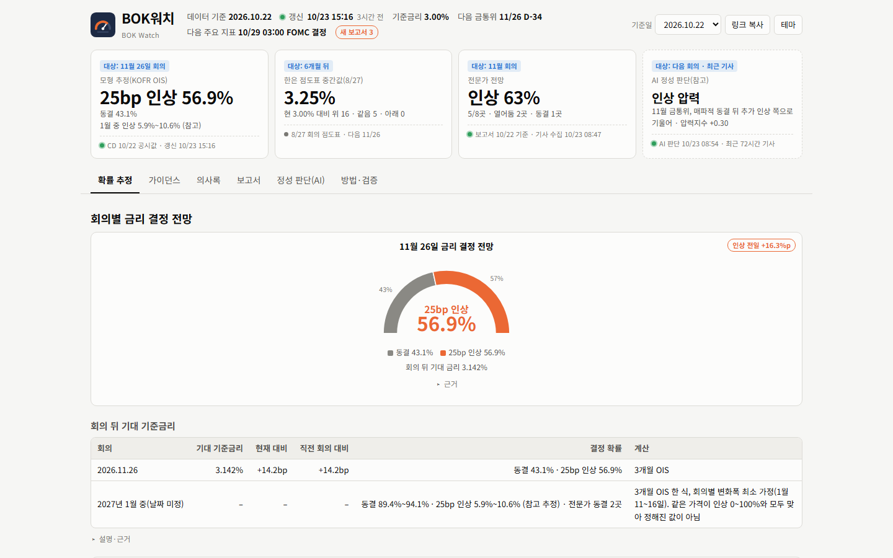

# [BOK워치] 증시 폭락, 금리 2~3번 올린 효과…한은 추가 인상에 ‘이중 긴축’ 우려

2026.11.23 · 중앙일보 · 김원 기자

주식시장은 무너지고, 금리는 더 오를 전망입니다. 증시 급락으로 가계의 주식 자산이 줄어드는 가운데 한국은행은 11월 26일 기준금리를 추가 인상할 것으로 예상됩니다. 저는 23일 중앙일보 기사에서 두 충격이 함께 나타날 때 벌어질 수 있는 ‘이중 긴축’의 위험을 짚었습니다.

씨티은행은 올해 하반기 국내 가계의 주식 자본손실을 약 563조원으로 추산했습니다. 주가 하락으로 인한 소비 위축이 성장과 물가에 미치는 영향은 기준금리를 0.50~0.75%포인트 올린 것과 맞먹을 수 있다는 분석입니다. 금리를 0.25%포인트씩 두세 차례 인상한 것과 비슷한 충격이라는 의미입니다.

이처럼 금융시장에서 이미 긴축 효과가 나타나는 가운데 한국은행은 기준금리를 연 3.00%에서 3.25%로 올릴 것으로 전망됩니다. 앞선 7월과 8월 연속 인상의 효과가 내년 소비에 본격 반영될 수 있다는 점도 변수입니다.

시장 기대를 수치로 확인하기 위해 제가 개발한 BOK워치도 참고했습니다. 11월 23일 확인한 모형의 26일 금리 인상 추정 확률은 71.8%였습니다. 이는 KOFR 관련 시장가격 등을 바탕으로 역산한 확률로, 금통위 결정을 확정적으로 예측하는 값은 아닙니다.

BOK워치 금리 결정 확률 그래프 화면(2026년 10월 23일 캡처). 본문에 적힌 11월 23일 확률과 시점이 다른 과거 화면입니다.

또 하나의 쟁점은 경제성장률 전망입니다. 반도체 가격 급등으로 산업별 GDP 가중치가 달라지면 성장률은 크게 높아질 수 있지만, 그 숫자가 곧바로 내수 회복을 뜻하지는 않습니다. 성장은 반도체가 이끄는데 주가 하락과 이자 부담은 가계 소비를 압박하는 상황이 통화정책의 고민을 깊게 만들고 있습니다.

이 글은 2026년 11월 23일 중앙일보에 실린 기사의 주요 내용을 정리하고, 관련 데이터 서비스인 BOK워치를 함께 소개합니다.

중앙일보 기사 원문: https://www.joongang.co.kr/article/25481156

BOK워치: https://bokwatch.pages.dev/
