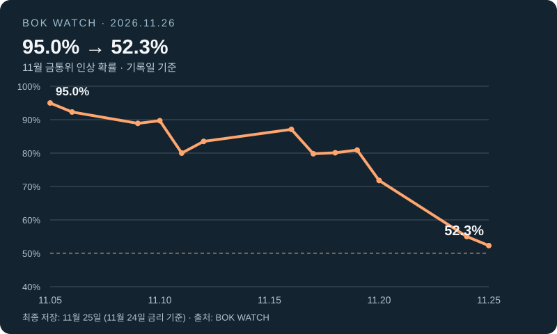

# [BOK워치] 95%에서 52.3%로…흔들린 시장의 확신과 BOK워치의 다음 실험

2026.11.26 · 프로딴짓러

한국은행은 금리를 올렸습니다. 하지만 금통위가 가까워질수록 시장의 확신은 약해졌습니다.

한국은행 금융통화위원회는 26일 기준금리를 연 3.0%에서 3.25%로 인상했습니다. 올해 들어 세 번째 인상입니다.

BOK워치가 추적한 시장의 통화정책 기대는 이달 들어 극적인 변화를 보였습니다.

## 3주 만에 42.7%포인트 하락

| 기록일 | 인상 확률 |
| --- | --- |
| 11월 05일 | 95.0% |
| 11월 06일 | 92.3% |
| 11월 09일 | 88.9% |
| 11월 10일 | 89.7% |
| 11월 11일 | 80.0% |
| 11월 12일 | 83.5% |
| 11월 16일 | 87.1% |
| 11월 17일 | 79.8% |
| 11월 18일 | 80.1% |
| 11월 19일 | 80.9% |
| 11월 20일 | 71.8% |
| 11월 24일 | 55.0% |
| 11월 25일 | 52.3% |

11월 초 95%에 달했던 인상 확률은 최종 저장 전망에서 52.3%까지 떨어졌습니다. 불과 3주 만에 42.7%포인트 하락했습니다. 최종 예측은 11월 25일 기록(11월 24일 시장금리 기준)입니다.

## 시장은 왜 금리 인상을 의심했을까

가장 주목할 변수는 증시 급락입니다.

AI 산업의 투자 수익성에 대한 우려가 커지면서 국내외 증시가 큰 폭으로 조정됐습니다. 주가 하락에 따른 가계의 자산 감소는 소비를 위축시키고, 기준금리를 올리지 않아도 금융 여건이 긴축적으로 바뀌는 효과를 낳습니다.

여기에 기준금리 인상까지 더해지면 실물경제가 ‘이중 긴축’에 직면할 수 있습니다.

신현송 한국은행 총재도 이날 기자간담회에서 주가 하락이 금융 여건을 긴축적으로 변화시키고 민간소비를 위축시킨다는 점을 인정했습니다.

한은은 올해 민간소비 증가율 전망치를 2.1%에서 1.8%로 낮췄습니다.

## 한국은행의 선택

한은은 반도체 호황을 근거로 내년 경제성장률 전망치를 4.1%로 높였습니다. 반도체 기업의 이익이 성과급과 배당금, 재정지출 등을 통해 경제 전반으로 확산할 것으로 판단했습니다.

금통위원들의 6개월 후 조건부 금리 전망(점도표)에서도 추가 긴축 가능성이 확인됐습니다.

| 기준금리 전망 | 점도표 |
| --- | --- |
| 3.25% | 6개 |
| 3.50% | 8개 |
| 3.75% | 7개 |

전체 21개 점 가운데 15개(71.4%)가 추가 인상을 가리켰습니다. 다만 이번 금리 인상 결정에는 두 명의 금통위원이 동결 소수의견을 냈습니다.

## BOK워치의 예측 성적표

| 구분 | 인상 전망 |
| --- | --- |
| BOK워치 11월 23일 종가 기준 | 55.0% |
| BOK워치 최종 저장 전망 | 52.3% |
| 금융투자협회 설문 | 54.0% |
| 전문가 전망 | 19곳 중 19곳 인상 |
| 실제 결과 | 0.25%p 인상 |

BOK워치의 최종 저장 전망은 실제 금통위 결정과 방향이 일치했습니다. 금융투자협회 설문조사 결과와도 비슷한 수준이었습니다.

하지만 52.3%라는 확률은 인상과 동결 사이에서 모형의 전망이 팽팽했음을 의미합니다. 이번 결과를 적중으로 기록하더라도 모형의 예측력이 충분히 입증됐다고 볼 수는 없습니다.

## 현재 모형의 한계

BOK워치는 자체 합성 KOFR OIS와 91일물 통안증권 금리를 각각 50%씩 반영해 통화정책 기대를 추정합니다.

하지만 시중금리에는 기준금리 전망 외에도 다양한 요인이 반영됩니다.

- 국내 금리 스와프 시장의 제한적인 유동성
- 채권시장의 위험 및 기간 프리미엄
- 금융시장 충격에 따른 정상적인 금리 스프레드의 변화
- 두 지표를 동일한 비중으로 반영하는 방식의 적절성
- 충분히 축적되지 않은 실시간 예측 기록

특히 미국 페드워치와 달리 국내에서는 정책금리 기대를 직접 읽을 수 있는 선물시장이 충분히 활성화되지 않았습니다.

BOK워치가 제시하는 확률은 시장에서 직접 관측되는 확률이 아니라 시장금리를 바탕으로 모형이 추정한 값입니다.

## NEXT: BOK WATCH 3.0

이러한 한계를 보완하기 위해 BOK워치 3.0 개편 작업을 진행하고 있습니다.

이번 개편의 핵심은 새로운 지표를 무작정 추가하는 것이 아니라 기존 예측 모형의 성능부터 검증하는 것입니다.

과거 금통위 결정과 시장금리 데이터를 활용해 OIS 단독 모형, 통안증권 단독 모형, 기존 50대 50 결합 모형 등을 동일한 조건에서 비교하고 있습니다.

검증 과정에서는 단순 적중률뿐 아니라 확률 예측의 정확성을 평가하는 브라이어 점수(Brier Score), 확률의 신뢰도, 시장 충격에 대한 민감도 등을 살펴봅니다.

현재까지의 중간 검증에서는 기존 결합 모형이 OIS 단독 모형보다 우수한 성능을 보였지만, 통안증권 단독 모형보다 우수하다고 단정할 만한 근거는 확보되지 않았습니다.

기존 모형을 유지하는 것이 나을 수도 있고, 새로운 모형이 더 좋은 결과를 낼 수도 있습니다.

결론을 먼저 정해놓지 않고 데이터와 검증 결과에 따라 판단하겠습니다.

## 예측도 검증의 대상입니다

확률 예측의 가치는 미래를 맞히는 데에만 있지 않습니다. 시장이 미래를 어떻게 바라보고 있는지, 그 기대가 어떤 사건을 계기로 달라지는지를 추적하는 데에도 있습니다.

예측의 성공뿐 아니라 실패와 한계도 기록하고, 사전에 정한 기준에 따라 모형을 검증하는 것 역시 데이터저널리즘의 중요한 과정입니다.

이제 시장의 관심은 추가 인상 시점과 최종 기준금리 수준으로 옮겨갑니다.

BOK워치는 시장의 기대를 추적하는 도구에서, 그 예측력까지 스스로 검증하는 도구로 진화하고자 합니다.

BOK WATCH 3.0 — 개발 진행 중

https://bokwatch.pages.dev/
